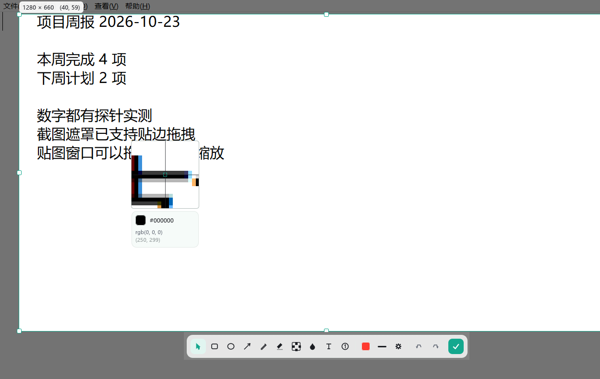
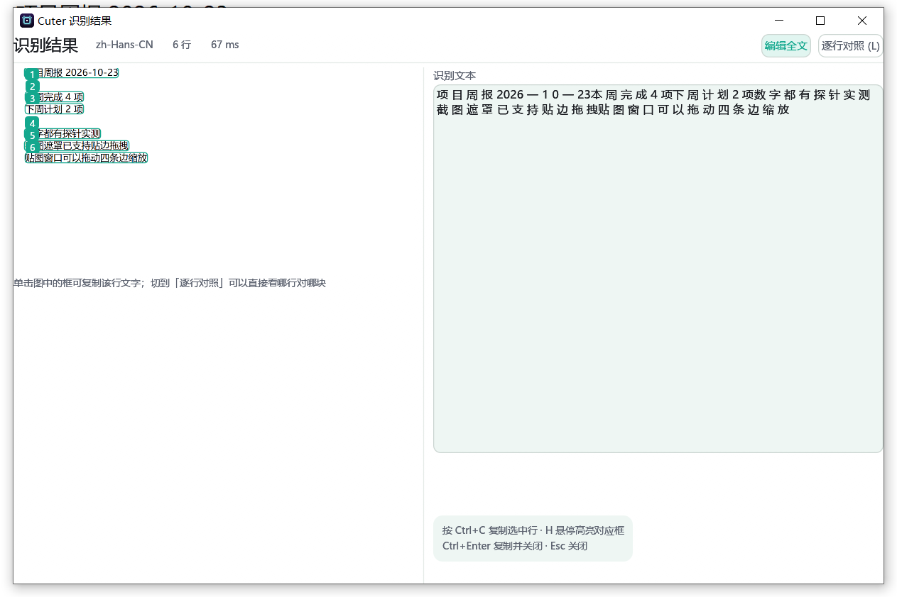

# Cuter

Windows 上的截图工具。按下热键，屏幕先冻住，再框选、标注、复制或者贴到屏幕上；也能把一段不断往下滚的长页面拼成一张长图，或者把框住的地方识别成文字。

Rust + egui 写的，单个 exe，不用装运行时。

**[下载最新版](https://github.com/ChuGe1206/Cuter/releases/latest)** · Windows 10/11 x64

## 长这样





## 能干什么

**截图。** 热键按下先捕获整个桌面再显示遮罩，所以框选过程中画面不会变，也不会拍到别的窗口闪一下。框选会吸附窗口边缘和屏幕中线，按住 Alt 临时关掉吸附。八向控制点、方向键微调（Shift 十倍）、Ctrl+A 全选、Ctrl+R 复原上一次的选区、双击确认、右键取消。

**标注。** 矩形、椭圆、箭头、画笔、荧光笔、马赛克、模糊、文字、序号。颜色和线宽可调，能撤销重做。

**贴图。** 截完直接按 Alt+V 贴到屏幕上，滚轮缩放，不透明度、投影、鼠标穿透都能调，还能分组。贴图可以按住 Ctrl 拖到资源管理器或聊天窗口里。

**长截图。** Alt+S 进滚动模式，框好区域回车开始，然后你自己在目标窗口里往下滚，程序定时抓同一块区域、按行匹配算位移再拼起来。纵向横向都认，往回滚也不会重复。

**识别文字。** 框选后 Ctrl+O，左边是图、右边是文字，图上的文本块点一下就复制那一行，光标移到右边某一行，图上对应位置会高亮。默认走 Windows 自带的 OCR（离线、零下载），嫌不够准可以接自己搭的 PaddleOCR 服务。

**截图历史。** 每次成功交付的截图都会存一份无损原图，托盘菜单里能翻回去再复制、再贴图或者删掉。

**命令行。** `--full`、`--monitor`、`--region`、`--pin`、`--tray`、`--history` 这些，脚本里用得上。

界面中英双语，设置 → 通用里切换。

## 快捷键

| 操作 | 默认键 |
|---|---|
| 框选截图 | `Alt+C` |
| 截取当前显示器 | `Alt+X` |
| 滚动截屏 | `Alt+S` |
| 贴图（剪贴板图片） | `Alt+V` |
| 隐藏 / 显示全部贴图 | `Alt+H` |
| 切到下一个贴图组 | `Alt+G` |

都能在设置里改。框选之后还有：回车保存、Ctrl+C 复制、Ctrl+O 识别、Ctrl+A 全选、Esc 取消。

## 下载

两个文件，都是 64 位，Windows 10 / 11 能用：

- `cuter-<版本>-portable-x64.zip`：解压就能跑。exe 旁边放一个空的 `cuter.portable` 文件就进入便携模式，配置、日志、截图全落在 exe 旁边，不碰 `%APPDATA%`。
- `cuter-<版本>-x64-setup.exe`：装到 `%LOCALAPPDATA%\Programs\Cuter`，不需要管理员权限，卸载时保留设置和截图。

两个产物都没有代码签名，第一次运行 Windows 会弹「未知发布者」。介意的话用 zip 版，或者把解压目录加进 Defender 的排除项。

## 自己编译

需要 Rust 1.88 以上和 MSVC 工具链。

```shell
cargo build --release                                            # → target\release\cuter.exe
powershell -File .\tools\package\portable_zip.ps1                # → dist\cuter-<版本>-portable-x64.zip
powershell -File .\tools\package\build_installer.ps1             # → dist\cuter-<版本>-x64-setup.exe
```

exe 带版本资源和图标。改了图标图形要重跑 `cargo run -p cuter-app --example dump_icon -- crates/cuter-app/assets/cuter.ico`，不然资源段里还是旧的。

## 怎么验证的

截图软件的很多行为单测证明不了：截出来的像素对不对、遮罩上有没有混进自己的窗口、托盘菜单点 Esc 会不会关、贴图拖进资源管理器对方收不收得到。所以 `tools/probe/` 下面有 32 个桌面探针，真的开窗口、真的发按键、真的抓屏幕，然后对着像素和日志断言，通过退出码 0，失败 1，环境不允许跑（比如别的程序占着键盘）2。

```shell
cargo test --workspace                                            # 348 个单测，不需要桌面
powershell -File .\tools\probe\run_all.ps1 -Quick                 # 26 个快速探针
powershell -File .\tools\ci\check.ps1                             # 门禁：clippy + 单测 + i18n + 文档引用 + release 构建
```

门禁里任何一步失败都返回非零。文档里的每个数字都是这么跑出来的，`docs/HANDOFF.md` 记着每个 bug 是怎么定位的、用什么判据确认修好了。

## 几个数字

| | 实测 |
|---|---|
| exe | 8.6 MB（便携包 4.2 MB） |
| 冷启动到遮罩可见 | 约 0.6 秒 |
| `--full`：进程启动到 PNG 落盘 | 中位 140~170 ms |
| 托盘待命（私有内存） | 约 29 MB，闲置半分钟工作集收回个位数 |

这些是我自己那台机器（1080p、125% 缩放）上量的，换机器会有差别，也会随版本变。复现命令在 `tools/probe/perf_probe.ps1` 和 `latency_probe.ps1`。

至于「比 Electron 系省多少」，我不打算在 README 里跟别人比：这里的一切都是自己量的，别人的数字我复现不了。

## 还没做的

- **代码签名**。没有证书，所以首次运行会有 SmartScreen 提示。
- **多显示器混合缩放**没验证过，开发机只有一块屏。检测到混合缩放时程序会提示改用「当前显示器」。
- **屏幕翻译、以图搜图**没做。
- **自动滚动**（让程序自己滚，而不是人滚）在很多程序里不生效，所以默认关着。
- macOS / Linux 只有架构位置，没有实现。

## 文档

- [`docs/HANDOFF.md`](docs/HANDOFF.md) —— 开发日志，93 节，一节一个 bug 的定位过程
- [`docs/MAINTAINER.md`](docs/MAINTAINER.md) —— 上手、不能破的规矩、发布流程
- [`docs/RELEASES.md`](docs/RELEASES.md) —— 每一版的变化
- [`docs/config-audit.md`](docs/config-audit.md) —— 配置项和代码作用点的对照表
- [`docs/design/`](docs/design) —— 设计系统、稿子、实现对照
- [`tools/probe/`](tools/probe) —— 那 32 个探针

## 许可

GPL-3.0-or-later。
