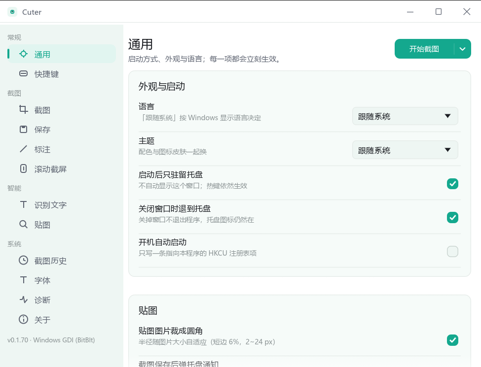

# Cuter

[](LICENSE)
[](https://github.com/ChuGe1206/Cuter/releases/latest)
[](https://github.com/ChuGe1206/Cuter/releases/latest)
[](rust-toolchain.toml)

Windows 上的截图与标注工具。按下热键后先冻结整个桌面再显示遮罩，框选过程画面不会变动；截图可以标注、复制、保存或贴回屏幕，也能把滚动的长页面拼成一张长图，或者框出一块区域识别成文字。

Rust + egui 实现，单个 exe，不需要安装运行时。

**[下载最新版](https://github.com/ChuGe1206/Cuter/releases/latest)**

## 目录

- [截图](#截图)
- [功能](#功能)
- [安装](#安装)
- [快速上手](#快速上手)
- [配置与数据](#配置与数据)
- [从源码构建](#从源码构建)
- [项目结构](#项目结构)
- [测试与验证](#测试与验证)
- [性能](#性能)
- [已知限制](#已知限制)
- [反馈问题](#反馈问题)
- [许可证](#许可证)

## 截图

框选区域，八向控制点可调整，下方是标注工具条：


识别文字：左侧是图，右侧是文字，点框复制该行，悬停文字高亮对应框：


设置界面：



## 功能

**截图**

- 全屏冻结后框选，画面与按下热键时完全一致
- 吸附到窗口边缘、屏幕中线与控件边界，按住 `Alt` 临时关闭吸附
- 八向控制点、方向键微调（`Shift` 加速）、`Ctrl+A` 全选、`Ctrl+R` 复原上次选区
- 双击确认，右键取消，`Esc` 退出

**标注**

- 矩形、椭圆、箭头、画笔、荧光笔、马赛克、模糊、文字、序号
- 颜色、线宽、字号可调，支持撤销与重做
- 标注在导出时才栅格化，预览与导出结果一致

**贴图**

- 截图直接贴回屏幕，滚轮缩放，可调不透明度、投影、鼠标穿透
- 贴图可以分组，`Alt+H` 隐藏或显示整组，`Alt+G` 切换分组
- 按住 `Ctrl` 把贴图拖进资源管理器或其他应用，对方会收到一个图片文件

**滚动截屏**

- 框好区域后自行滚动目标窗口，程序定时抓取同一块区域并按行匹配拼接
- 支持纵向与横向，往回滚不会产生重复内容
- 也可以让程序替你滚（`A` 键），对忽略合成滚轮的程序无效

**识别文字**

- 默认使用 Windows 自带的 OCR，离线运行，不下载模型
- 结果面板支持逐行对照，点框复制单行，悬停高亮
- 可以改用自己搭建的 PaddleOCR hubserving 服务，配置里填接口地址即可

**截图历史**

- 每次成功交付的截图都保留一份无损原图
- 托盘菜单可以翻回去重新复制、重新贴图或删除

**命令行**

```shell
cuter --full --out shot.png      # 截取整个桌面
cuter --monitor -m 1             # 截取指定显示器
cuter --region 100,100,800,600   # 截取指定区域
cuter --pin                      # 把剪贴板图片贴到屏幕上
cuter --tray                     # 启动并驻留托盘
```

**界面** 中英双语，设置 → 通用里切换。

## 安装

从 [Releases](https://github.com/ChuGe1206/Cuter/releases/latest) 下载任意一种，均为 Windows 10/11 x64：

| 形式 | 文件 | 说明 |
|---|---|---|
| 便携版 | `cuter-<版本>-portable-x64.zip` | 解压即用，配置、日志、截图历史都在 exe 旁边，不写系统目录 |
| 安装版 | `cuter-<版本>-x64-setup.exe` | 装到 `%LOCALAPPDATA%\Programs\Cuter`，不需要管理员权限，卸载时保留配置与历史 |

程序未做代码签名，首次运行 Windows 会提示「未知发布者」。介意的话使用便携版，并把解压目录加入 Defender 排除项。

## 快速上手

1. 双击 `cuter.exe`，程序驻留托盘
2. 按 `Alt+C` 框选区域
3. 需要标注就用下方工具条，不需要就直接回车保存或 `Ctrl+C` 复制

默认热键（设置 → 快捷键里可以改）：

| 操作 | 热键 |
|---|---|
| 框选截图 | `Alt+C` |
| 截取当前显示器 | `Alt+X` |
| 滚动截屏 | `Alt+S` |
| 贴图（剪贴板图片） | `Alt+V` |
| 隐藏或显示全部贴图 | `Alt+H` |
| 切换到下一个贴图组 | `Alt+G` |
| 识别文字 | `Alt+O` |

框选状态下另有：`Enter` 保存、`Ctrl+C` 复制、`Ctrl+O` 识别、`Ctrl+A` 全选、`Esc` 取消。

## 配置与数据

| 模式 | 配置文件 | 日志 | 截图历史 |
|---|---|---|---|
| 便携版 | `config.toml`（exe 旁边） | `logs\cuter.log` | `data\history\` |
| 安装版 | `%APPDATA%\Cuter\config.toml` | `%APPDATA%\Cuter\logs\cuter.log` | `%LOCALAPPDATA%\Cuter\history\` |

便携模式通过 exe 旁边的空文件 `cuter.portable` 触发。配置文件损坏时程序会备份原文件（带时间戳）并回退默认值，状态栏会提示备份位置。

设置 → 诊断可以查看捕获后端、启动耗时、显示器信息，并提供打开配置目录与日志目录的入口。

## 从源码构建

需要 Rust 1.88 或更高版本、MSVC 工具链，Windows 10/11 x64。

```shell
cargo build --release                 # 产物：target\release\cuter.exe
cargo test --workspace                # 单元测试，无需桌面
```

打包产物（可选，需要 Inno Setup，脚本会自动下载免安装版本）：

```shell
powershell -File .\tools\package\portable_zip.ps1      # dist\cuter-<版本>-portable-x64.zip
powershell -File .\tools\package\build_installer.ps1   # dist\cuter-<版本>-x64-setup.exe
```

修改图标后需要重新生成 ico 文件，否则资源段里仍是旧图标：

```shell
cargo run -p cuter-app --example dump_icon -- crates/cuter-app/assets/cuter.ico
```

## 项目结构

| crate | 职责 |
|---|---|
| `cuter-core` | 位图、几何、屏幕捕获、滚动拼接、OCR 接口、配置。不依赖窗口库，可无头测试 |
| `cuter-ui` | 遮罩、工具条、标注、贴图、各面板、主题与 i18n |
| `cuter-app` | 窗口与视口、托盘、全局热键、单实例、桌面集成 |

`tools/probe/` 是桌面端到端探针，`tools/ci/check.ps1` 是提交门禁，`tools/package/` 是打包脚本。

## 测试与验证

截图类软件的很多行为单元测试证明不了：像素内容是否正确、遮罩里会不会混进自己的窗口、托盘按 `Esc` 是否关闭、贴图拖进资源管理器对方能否收到。因此项目提供一组真实操作桌面的探针：开窗口、发按键、抓屏幕，对着像素和日志断言。

```shell
cargo test --workspace                             # 348 个单元测试（另有 11 个需要桌面的被忽略）
powershell -File .\tools\probe\run_all.ps1         # 32 个桌面探针，约 25 分钟
powershell -File .\tools\probe\run_all.ps1 -Quick  # 26 个快速探针，约 5 分钟
powershell -File .\tools\ci\check.ps1              # 提交门禁：clippy + 单测 + i18n + 文档引用 + release 构建
```

探针退出码：`0` 通过，`1` 失败，`2` 环境不允许运行（例如键盘被其他程序占用）。跳过不等于通过，`run_all.ps1` 会单独列出。

## 性能

在开发机（1080p、125% 缩放、单显示器）上实测：

| 指标 | 数值 |
|---|---|
| exe 体积 | 8.6 MB（便携包 4.2 MB） |
| 冷启动到遮罩可见 | 约 0.6 秒 |
| `--full` 进程启动到 PNG 落盘 | 中位 140 到 170 ms |
| 托盘待命私有内存 | 约 29 MB，闲置半分钟后工作集回收到个位数 MB |

换机器会有差异，也可能随版本变化。复现命令见 `tools/probe/perf_probe.ps1` 与 `tools/probe/latency_probe.ps1`。

## 已知限制

- **未签名**：首次运行会触发 SmartScreen 提示，Defender 曾误报 `Behavior:Win32/Persistence.A!ml`（程序会写开机自启项并常驻热键，无签名时缺少信任来源）
- **多显示器混合缩放未验证**：开发环境只有单屏，检测到混合缩放时程序会提示改用「当前显示器」
- **屏幕翻译、以图搜图未实现**：这类功能需要外部 HTTP 端点，程序不内置服务
- **自动滚动**在部分程序中无效，它们忽略合成的滚轮消息
- **macOS / Linux 未实现**：`ScreenCapture` trait 已隔离平台差异，但 Wayland 不提供帧缓冲，无法实现冻结遮罩

## 反馈问题

提 issue 时请附上：

- 系统版本与显示缩放比例
- 设置 → 诊断页面的截图（含捕获后端与启动耗时）
- `logs\cuter.log` 最后一段（诊断页有「打开日志目录」）

## 许可证

[GPL-3.0-or-later](LICENSE)。
